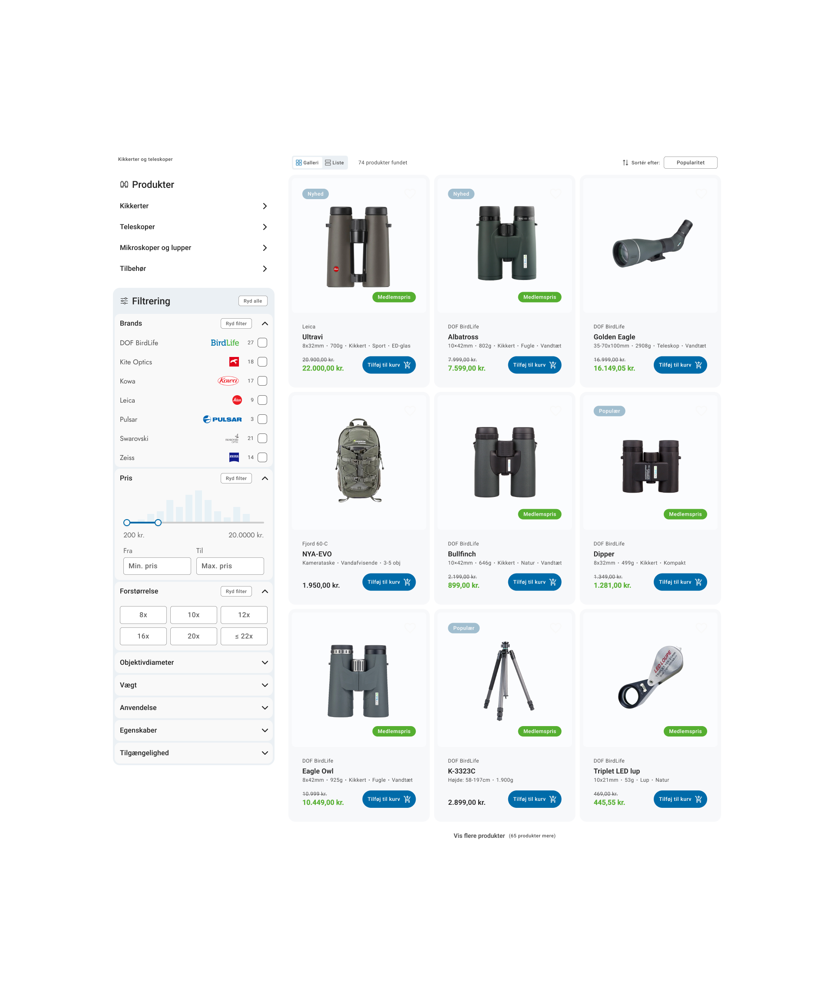
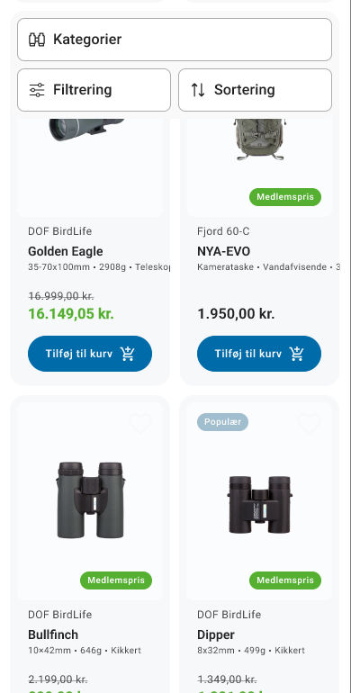

# Naturbutikken – product listing prototype

A redesign of the product browsing and filtering experience for [Naturbutikken.dk](https://naturbutikken.dk), an outdoor shop focused on bird watching. Made as a design challenge and built as a working prototype for usability testing.

**Try it live:** https://sonny-holmberg.github.io/naturbutikken-prototype/



## The problem

The current listing page is a likely cause of high bounce and low conversion:

- No real filtering, only a large grid of categories at the top of the page that disappears while you browse
- An uneven product grid with varying card and image sizes, which makes products hard to scan and compare
- Product cards with little information and no clear hierarchy
- Pagination that breaks the browsing flow, and is especially awkward on mobile
- "Add to cart" only visible on hover, which doesn't work on touch devices

## Who it's for

The filters are built around four types of customers:

- **The spec-focused buyer** knows the magnification and objective size they want and expects to filter on technical specs
- **The brand-loyal buyer** wants to go straight to DOF BirdLife, Zeiss, Leica or another brand
- **The gift buyer** is unsure about specs, is guided by price and recommendations, and leaves quickly if the page feels complex
- **The activity-driven buyer** knows what they want to do (bird watching, hiking, sailing) but not what to buy

## Design decisions

- **Structured categories** with main and subcategories, plus breadcrumbs, instead of one flat grid
- **Always-visible filters**: a sticky sidebar on desktop, a sticky top bar with slide-in drawers on mobile
- **Filter types matched to the data**: brand checkboxes with logos, price and weight sliders with a histogram, chips for magnification and objective size, activity chips for use
- **Live counts** on every option, with options that would give zero results dimmed
- **Clear product cards** with consistent image sizes, key specs, before/after price and an always-visible "Tilføj til kurv" button
- **Progressive loading** with "Vis flere produkter" instead of pagination
- **Shareable state**: filters live in the URL, so a filtered view can be shared and the back button works

## Mobile



Same card principles as desktop, in a two-column grid. Categories, filters and sorting open as bottom sheets from a sticky top bar.

## About the prototype

Not a real shop. The 74 products are mock data. Built with Vite, React, TypeScript, Tailwind CSS v4, Radix UI, Vaul and Lucide.

<details>
<summary>For developers</summary>

```bash
npm install
npm run dev
```

Then open http://localhost:5173/naturbutikken-prototype/

Every push to `main` deploys to GitHub Pages via `.github/workflows/deploy.yml`.

Content lives in `src/data/` (products, taxonomy, brands) and filter logic in `src/lib/filters.ts`. Raw images go in `assets/` (not committed). Run `npm run images` to regenerate `public/img/`.

</details>

---

© 2026 Sonny Holmberg. All rights reserved. Shared for portfolio and review purposes.
